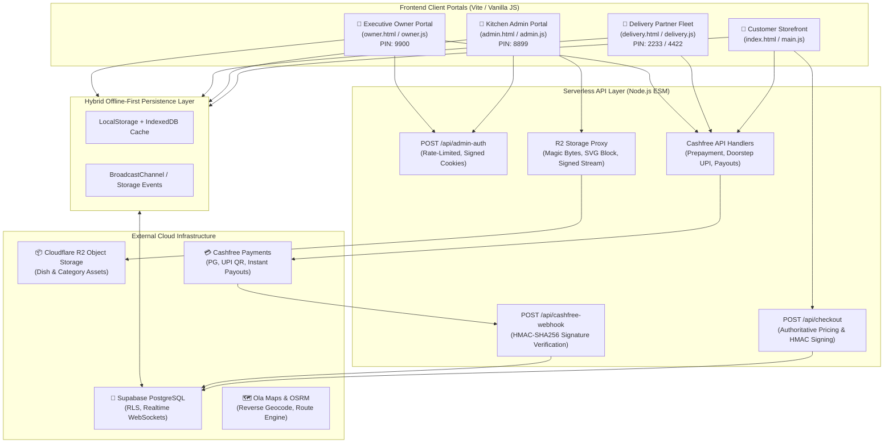

# Savera Paradise — Complete System Architecture & A-to-Z Workflow Blueprint

This document details the end-to-end architecture, user journeys, data pipelines, business logic, security boundaries, and technical implementations across the entire **Savera Paradise** restaurant ordering ecosystem.

---

## 1. System Topology & Technology Stack



---

## 2. Core Portals & User Journeys (A to Z)

---

### Portal 1: Customer Storefront (`index.html` & `main.js`)

The customer storefront is a responsive, mobile-first Progressive Web App (PWA) designed for frictionless food ordering.

#### A. Progressive Web App (PWA) Engine
- **Universal Detection**: Evaluates environment (iOS Safari, Android Chrome, in-app webviews like Instagram/WhatsApp) via `detectPlatformEnvironment()`.
- **Install Flow**: Caches early `beforeinstallprompt` in `window.__deferredPwaPrompt`. Displays custom install prompt bottom sheet. On iOS, shows browser-tailored step-by-step visual guides with SVG badges.
- **Service Worker (`sw.js`)**: Offline caching of static CSS, JS, fonts, and assets for instant load times.

#### B. Menu Browsing, Search & Kinetic Categories
- **135+ Authentic Dishes**: Categorized into Biryani, Starters, Kebabs, Curries, Rotis, Desserts, and Beverages.
- **Kinetic Spin Carousel**: Horizontal scrolling categories rotate angularly using continuous degree calculations without jitter.
- **View All Modal**: Vertical list with proportional rotation displaying all categories and dish counts.
- **Live Search & Filter**: Real-time keyword search across dish names, tags, ingredients, and categories.

#### C. Dish Details Modal & Stepper Controls
- **Card Steppers**: Food cards feature high-visibility resting "+ Add" buttons that transform into quantity pill steppers (`- 1 +`) upon selection.
- **Particle Flying Micro-Animation**: Smooth 60fps trajectory animation flying a duplicate dish icon to the cart icon upon addition.
- **Detailed Modal**: High-res dish imagery, spice level indicators, portion size descriptions, and nutritional/dietary badges.

#### D. Dynamic Wholesale Club Deals & Threshold Pricing (Wholesale Bazaar Mode)
- **Wholesale Price Badges**: When enabled, every dish card renders a deal price badge (`meta-deal-price`), displaying the discounted price (e.g. `₹104` instead of `₹130`).
- **Floating Progress Bar**: 
  - Subtotal below threshold (e.g. ₹299): Displays remaining spend required:
    > *"Add ₹169 more to unlock 20% OFF special prices!"*
  - Subtotal meets or exceeds threshold: Transforms into unlocked celebratory banner:
    > *"🎉 Deals Unlocked! You save ₹68 (20% OFF)!"*
- **Single-Tap Drawer Access**: Tapping the floating bar smoothly slides open the Cart Drawer.
- **Multi-Promotion Co-Existence**: Wholesale deals co-exist with standard promo coupons (`SAVERA20`, `FIRSTORDER`) and free delivery rules ($\ge$ ₹250).

#### E. Cart Drawer & Financial Calculation
- **Subtotal Calculation**: Dynamic summation of item prices $\times$ quantities.
- **Discount Engine**:
  $$\text{Discount} = \text{round}\left(\frac{\text{Subtotal} \times \text{DealPct}}{100}\right)$$
- **Delivery Fee Rules**:
  - Subtotal $\ge$ ₹250: **FREE Delivery** (₹0).
  - Subtotal $<$ ₹250: Standard Delivery Fee (₹40).
- **Promo Coupon Application**: Validates minimum order thresholds (e.g. `SAVERA20` requires ₹199 subtotal).
- **Payable Total**:
  $$\text{Grand Total} = \text{Subtotal} - \text{Discount} + \text{Delivery Fee}$$

#### F. Address & Geolocation Engine
- **GPS Location Detection**: Retrieves user latitude/longitude via HTML5 Geolocation.
- **Reverse Geocoding**: Queries Ola Maps API / OpenStreetMap to convert GPS coordinates into verified street, area, and city names.
- **Saved Address Book**: Multi-address management (Home, Work, Other) synchronized bi-directionally between `localStorage` and Supabase `user_addresses`.
- **Delivery Radius Enforcer**: Haversine distance calculation from restaurant coordinates ($12.7214^\circ\text{N}, 77.2798^\circ\text{E}$); alerts customer if delivery address exceeds allowable radius (default 7 km).

#### G. Checkout & Payment Selection
- **Payment Modes**:
  1. **Cash on Delivery (COD)**: Order placed instantly with pending cash collection.
  2. **Online Prepayment**: Initiates Cashfree PG session for UPI, NetBanking, Credit/Debit cards.
- **Multi-Order Rate Limiting**: Prevents a customer from placing more than 2 simultaneous active orders to prevent kitchen congestion. Displays a safe notification banner linking to active order tracking.

#### H. Live 5-Step Order Tracking & Realtime Updates
- **Interactive Tracker**:
  1. `Accepted` $\rightarrow$ 2. `Preparing (Cooking)` $\rightarrow$ 3. `Ready to Dispatch` $\rightarrow$ 4. `Dispatched (On the Way)` $\rightarrow$ 5. `Delivered`
- **Interactive Leaflet GPS Map**: Shows restaurant anchor, rider live coordinates, customer drop pin, and animated vehicle routing.
- **Web Audio Sound Effects**: Custom audio notifications for order status transitions.

---

### Portal 2: Kitchen Admin & Store Manager Portal (`admin.html` & `admin.js`)

The command center for restaurant management, kitchen staff, and menu operations.

#### A. Master Passcode Unlock Screen
- **Passcode**: **`8899`**
- **Authentication**: Keypad input is hashed client-side with salted SHA-256 and authenticated server-side against `/api/admin-auth`.
- **Session Security**: Issues a cryptographically signed HMAC bearer token valid for 12 hours. Lockout enforced after 5 failed attempts via signed HTTP-only cookies.

#### B. Live Kitchen Order Queue
- **Realtime WebSocket Feed**: Listens to Supabase `orders` table changes.
- **Audio Chime Engine**: Web Audio oscillator sounds an audible kitchen alarm upon arrival of new orders until acknowledged.
- **Forward-Only Lifecycle Buttons**:
  - `Accept Order` $\rightarrow$ status becomes `accepted`.
  - `Start Cooking` $\rightarrow$ status becomes `cooking`.
  - `Ready for Pickup` $\rightarrow$ status becomes `ready_for_pickup`.
- **Handshake Bag Code (`bagPin`)**: Automatically generates a 4-digit numeric code (e.g. `4821`) stamped onto the parcel slip for rider verification.

#### C. Menu & Inventory Management
- **Add & Edit Dishes**: Name, category, price, description, spice level, veg/non-veg flag.
- **Image Pipeline**: Uploads dish photos directly through the secure Cloudflare R2 proxy (`/api/r2-upload`) with binary magic byte validation.
- **Stock Toggles**: Instant 1-click in-stock / out-of-stock toggle updates customer storefront immediately via broadcast channels.

#### D. Category Management
- Create, rename, delete, and reorder categories.
- Assign canonical category hero banners stored in Cloudflare R2.

#### E. Store Operations & Rush Controls
- **Rush Mode Pause**: Temporarily halts incoming storefront orders for 15, 30, or 45 minutes with a custom customer notice (e.g. "Kitchen at full capacity").
- **Store Hours & Open/Close Toggle**: Instantly opens or closes online ordering.
- **Delivery Radius Setting**: Adjustable radius slider (1 to 20 km).

#### F. Promotions & Wholesale Deals Control Center
- **Wholesale Deals Switch**: Toggle Wholesale Club Deals active/inactive.
- **Spend Threshold Input**: Minimum cart spend to unlock deal (default ₹299).
- **Discount Percentage Input**: Wholesale discount percentage (default 20%).
- **Live Preview Card**: Renders real-time customer banner preview and sample math before saving to `store_settings`.

---

### Portal 3: Delivery Partner Fleet Portal (`delivery.html` & `delivery.js`)

Mobile interface for delivery riders to claim packages, navigate routes, and collect payments.

#### A. Rider Passcode Unlock Screen
- **Rider PINs**: **`2233`**, **`4422`**, **`4455`**, **`8811`**
- Matches against authorized salted SHA-256 hashes (`DEFAULT_RIDER_PIN_HASHES`).
- Loads individualized rider profile, vehicle type, and shift earnings.

#### B. Shift Dashboard & Payout Tracker
- **Online / Offline Toggle**: Controls rider availability in dispatch queue.
- **Earnings Breakdown**: Shift base pay, per-kilometer rates, milestone bonuses, and tips.
- **Live GPS Tracking**: Transmits rider coordinates periodically to update customer tracking map.

#### C. Available Orders & Kitchen Handshake Protocol
- **4-Digit Bag Code Verification**:
  - Rider arrives at the kitchen counter and enters the 4-digit code from the food bag into `#input-bag-code`.
  - **Route Preview Modal (`role="dialog"`)**:
    - Customer name and masked phone number (`+91 98450 12345`).
    - Clean delivery address with landmark extraction.
    - Haversine route distance with `NaN` fallback guard ($1.8\text{ km}$).
    - Calculated ride time: $\max(5, \text{round}(\text{Distance} \times 3.5))\text{ mins}$.
    - Payment liability flag: `💵 COD: Collect ₹Amount` vs `💳 Prepaid Online (₹0 to collect)`.
    - Calculated rider payout for this delivery.
  - Tapping **"Claim & Start Ride"** transitions order to `on_the_way` and assigns it exclusively to the rider's PIN.

#### D. Customer Unreachable Protocol
- Triggered if customer does not answer door or phone.
- Starts a 3-minute countdown timer.
- Pushes automated SMS / notification alert to customer app.
- Logs failure timestamp if order must be marked `undelivered` and returned to kitchen.

#### E. Doorstep Payment Collection Engine
- **Mode 1 — Cash on Delivery (COD)**: Collects physical cash; records liability in the rider's physical cash drawer account.
- **Mode 2 — Dynamic Doorstep UPI QR Code**:
  - Rider selects "Generate UPI QR".
  - System generates an Indian NPCI-compliant UPI URI:
    ```
    upi://pay?pa=saveraparadise@okhdfcbank&pn=Savera%20Paradise&am=312.00&tr=QB9988&cu=INR
    ```
  - Displays instant high-resolution QR code on rider's screen.
  - Customer scans with PhonePe, Google Pay, Paytm, or BHIM.
  - Does **not** add physical cash to rider's drawer liability.

#### F. Delivery Confirmation
- Rider confirms delivery $\rightarrow$ order status becomes `delivered`.
- Delivers customer push notification and completes transaction.

---

### Portal 4: Executive Owner Portal (`owner.html` & `owner.js`)

Executive oversight for store owners, accounting reconciliation, and fleet disbursements.

#### A. Executive Passcode Unlock Screen
- **Passcode**: **`9900`**
- Verified against `/api/admin-auth` issuing `role: 'owner'` signed bearer token.

#### B. Financial Intelligence Dashboard
- **Total Gross Sales**: Sum of all delivered orders within selected timeframe (Today, 7 Days, Month, All-Time).
- **Food Cash Drawer (Liability)**: Physical cash collected by riders on COD deliveries that must be deposited at the store counter.
- **Bank Direct (Settled)**: Net revenue collected directly into bank via online prepayment and doorstep UPI QR.
- **Fleet Metrics**: Total road kilometers driven, average delivery times, fulfillment rates.

#### C. Shift Payout Settlement Engine
- Formula:
  $$\text{Payout} = \text{BasePay (₹35)} + (\text{DistanceKm} \times \text{ExtraKmRate (₹5)}) + \text{Surge}$$
- **Instant Cashfree Payout**: Executive Owner can trigger direct bank/UPI payouts to riders with a single tap. Verified server-side via `POST /api/cashfree-payout`.

---

## 3. Serverless API Architecture (`api/`)

| Endpoint | Method | Security / Auth | Responsibilities |
| :--- | :---: | :--- | :--- |
| [`/api/checkout`](file:///c:/Users/DELL/Projects/resturent2/api/checkout.js) | `POST` | Public / Origin Whitelist | <ul><li>Overrides client prices with authoritative catalog prices.</li><li>Evaluates Wholesale Deal threshold ($\ge$ ₹299).</li><li>Clamps discount $\le 50\%$.</li><li>Signs payload with HMAC-SHA256 (`checkoutToken`).</li></ul> |
| [`/api/admin-auth`](file:///c:/Users/DELL/Projects/resturent2/api/admin-auth.js) | `POST` | Rate-Limited / Cookie State | <ul><li>Validates Manager PIN (`8899`) or Owner PIN (`9900`).</li><li>Constant-time comparison via `crypto.timingSafeEqual`.</li><li>Issues signed 12-hour session bearer tokens.</li><li>Locks out after 5 consecutive failures for 15 minutes.</li></ul> |
| [`/api/cashfree-create-order`](file:///c:/Users/DELL/Projects/resturent2/api/cashfree-create-order.js) | `POST` | Verified `checkoutToken` | <ul><li>Validates cryptographic signature of cart total.</li><li>Creates pre-payment session with Cashfree PG.</li><li>Returns `payment_session_id` for Cashfree Web SDK.</li></ul> |
| [`/api/cashfree-generate-qr`](file:///c:/Users/DELL/Projects/resturent2/api/cashfree-generate-qr.js) | `POST` | Public / Valid Order ID | <ul><li>Constructs NPCI UPI intent string (`upi://pay?...`).</li><li>Formats merchant VPA, order tag, and exact amount.</li></ul> |
| [`/api/cashfree-webhook`](file:///c:/Users/DELL/Projects/resturent2/api/cashfree-webhook.js) | `POST` | Cashfree HMAC-SHA256 Sig | <ul><li>Validates `x-webhook-signature` against webhook secret.</li><li>Parses `PAYMENT_SUCCESS_WEBHOOK`.</li><li>Updates Supabase order: `payment_status: 'Paid'`, `payment_method: 'Online'`, `is_paid_online: true`.</li></ul> |
| [`/api/cashfree-payout`](file:///c:/Users/DELL/Projects/resturent2/api/cashfree-payout.js) | `POST` | Bearer Token (`role: 'owner'`) | <ul><li>Strictly permits Owner role; rejects kitchen admin (403).</li><li>Initiates instant transfer to rider bank / UPI VPA.</li></ul> |
| [`/api/r2-upload`](file:///c:/Users/DELL/Projects/resturent2/api/r2-upload.js) | `POST` | Admin Session Bearer Token | <ul><li>Enforces admin token.</li><li>Binary magic byte inspection (JPEG, PNG, WEBP, GIF).</li><li>Disallows SVG to eliminate stored XSS.</li><li>Directory traversal defense on keys.</li></ul> |
| [`/api/r2-delete`](file:///c:/Users/DELL/Projects/resturent2/api/r2-delete.js) | `POST` | Admin Session Bearer Token | <ul><li>Validates admin token.</li><li>Deletes assets from Cloudflare R2 bucket.</li></ul> |
| [`/api/r2-image`](file:///c:/Users/DELL/Projects/resturent2/api/r2-image.js) & [`/api/r2-video`](file:///c:/Users/DELL/Projects/resturent2/api/r2-video.js) | `GET` | Public Whitelist Key | <ul><li>Streams imagery/video with presigned S3 AWS SigV4.</li><li>Protected with try/catch exception shielding.</li></ul> |

---

## 4. Database Schema & Security Policies (Supabase PostgreSQL)

### A. Tables
1. **`orders`**: Order ID, customer details, address, items JSON, financial breakdown, payment mode, payment status (`Paid` / `Cash on Delivery`), order status (`accepted` to `delivered`), assigned rider, bag PIN (`bagPin`).
2. **`dishes`**: Dish ID, category, name, price, description, image URL, stock flag (`inStock`), spice level.
3. **`categories`**: Category ID, title, sort order, icon/image URL, dish count.
4. **`user_addresses`**: User ID, contact name, phone, address text, flat/door no, landmark, coordinates (`lat`, `lng`), default flag.
5. **`store_settings`**: Restaurant phone, operating hours, delivery radius, free delivery threshold, Wholesale Club Deals configuration (`unlockedDealsEnabled`, `unlockedDealsMinOrder`, `unlockedDealsDiscountPct`).
6. **`riders`**: Rider PIN hash, name, phone, vehicle, active status, current coordinates.

### B. Row Level Security (RLS) & Immutability Triggers
- **Customer Isolation**: Customers can only select orders where `auth.uid() = user_id`.
- **Status Reversal Protection**: Trigger `prevent_order_status_reversal()` blocks any query attempting to revert order status backwards.
- **Deletion Protection**: Trigger `prevent_order_deletion()` blocks all `DELETE` statements on `orders`.
- **Secret Isolation**: `SUPABASE_SERVICE_ROLE_KEY` is exclusively accessed server-side and is never bundled in frontend code.

---

## 5. Automated Verification & Quality Assurance Suite

The codebase includes **19 automated test suites** covering **679 test cases** (`node --test`):

1. **`cashfree-integration.test.js`**: PG session creation, NPCI UPI formatting, webhook HMAC verification, payout role boundaries.
2. **`unlocked-deals-threshold-pricing.test.js`**: Spend threshold math, wholesale discount calculations, co-existence with coupons, tamper clamping.
3. **`end-to-end-portal-integration.test.js`**: Cross-portal order flow from cart progression to kitchen acceptance, rider handshake, and owner payout.
4. **`checkout-api.test.js`**: Authoritative price overrides, free delivery boundaries, promo code logic (`SAVERA20`, `SAVE10`, `FIRSTORDER`).
5. **`security-utils.test.js`**: XSS entity escaping (`escapeHtml`), protocol sanitization (`sanitizeUrl`), phone formatting, salted SHA-256 PIN hashing.
6. **`r2-api-security.test.js`**: Cloudflare R2 token enforcement, magic byte validation, SVG rejection, key sanitization.
7. **`order-status-progression-lifecycle.test.js`**: Forward-only state transitions, tracker index synchronization.
8. **`rider-bag-preview-route.test.js`**: Handshake bag code verification, `NaN` distance fallback protection.
9. **`universal-pwa-install-flow.test.js`**: Platform detection, manifest compliance, service worker caching, iOS guide modals.
10. **`storefront-stepper-and-add-button.test.js`**: Add button transformation, stepper DOM synchronization, click propagation guards.

---

## 6. Access Credentials Quick Reference

| Role | Portal URL | Passcode | Authentication Method |
| :--- | :--- | :---: | :--- |
| **Store Manager & Kitchen Staff** | `/admin.html` | **`8899`** | Salted SHA-256 Hash + Serverless Token |
| **Fleet Delivery Riders** | `/delivery.html` | **`2233`** / **`4422`** / **`4455`** / **`8811`** | Salted SHA-256 Hash Roster |
| **Executive Store Owner** | `/owner.html` | **`9900`** | Salted SHA-256 Hash + Owner Token |
| **Customer Storefront** | `/` (`index.html`) | None | Open Access / Optional Google Auth |
